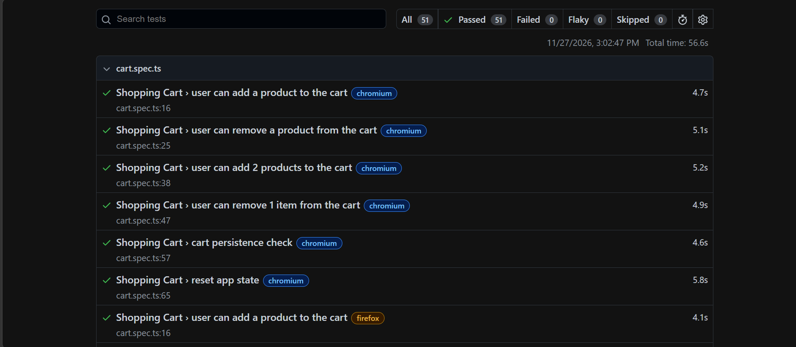

# 🎭 Playwright QA Automation Portfolio

Automated end-to-end testing project built using Playwright, TypeScript and SauceDemo.

The project demonstrates practical UI testing, Page Object Model design, reusable test data, and cross-browser testing across Chromium, Firefox and Webkit.


## 🛠️ Tech Stack
- 🎭 Playwright
- 🔷 TypeScript
- 🟢 Node.js
- 🧪 End-to-End Testing
- 🌐 Chromium · Firefox · WebKit
- 🏗️ Page Object Model

## 🧪 Test Coverage
### Authentication
- Successful login with a standard user
- Login validation for a locked-out user
- User logout
### Product & Inventory
- Product details validation
- Product sorting by price
- Navigation between inventory and product details
### Shopping Cart
- Add single and multiple products
- Remove products from the cart
- Cart badge validation
- Cart state persistence during navigation
- Reset application state
### Checkout
- End-to-end checkout flow
- Checkout form validation
- Validation of required customer information

## 📁 Project Structure

```text
playwright-qa-automation/
├── pages/
│   ├── CartPage.ts
│   ├── CheckoutPage.ts
│   ├── InventoryPage.ts
│   └── LoginPage.ts
│
├── test-data/
│   ├── products.ts
│   └── users.ts
│
├── tests/
│   ├── helpers/
│   │   ├── login.ts
│   │   └── checkout.ts
│   ├── cart.spec.ts
│   ├── checkout.spec.ts
│   ├── inventory.spec.ts
│   ├── login.spec.ts
│   ├── logout.spec.ts
│   └── pdp.spec.ts
│
└── playwright.config.ts
```
## 🏗️ Automation Approach

This project follows several test automation practices to keep the test suite maintainable and reusable:

- **Page Object Model (POM)** – page interactions are separated from test scenarios using classes such as `InventoryPage`, `CartPage`, and `CheckoutPage`.
- **Reusable helpers** – common workflows such as login and checkout are extracted into helper functions.
- **Centralized test data** – users and product information are stored separately from test logic.
- **Cross-browser testing** – tests run against Chromium, Firefox, and WebKit.
- **Independent tests** – Playwright fixtures and `beforeEach` setup help keep test scenarios isolated.

## ▶️ Running the Tests

### Prerequisites

Make sure you have installed:

- Node.js
- npm
- Git

### Installation

Clone the repository and install the project dependencies:

```bash
git clone https://github.com/kvmnxsky/playwright-qa-automation.git
cd playwright-qa-automation
npm install
```

Install the Playwright browsers:

```bash
npx playwright install
```

### Run the Test Suite

Run all tests across the configured browsers:

```bash
npx playwright test
```

Run tests in headed mode:

```bash
npx playwright test --headed
```

Open the Playwright HTML report:

```bash
npx playwright show-report
```
## 📊 Test Report

The automated test suite is executed across Chromium, Firefox, and WebKit.

The current suite contains **51 passing tests** with **0 failures, 0 flaky tests, and 0 skipped tests**.



## 🎯 Skills Demonstrated

- Writing maintainable end-to-end tests with Playwright and TypeScript
- Designing reusable Page Objects
- Creating reusable helpers for common test flows
- Organizing test data separately from test logic
- Working with Playwright locators, filters, and assertions
- Testing dynamic UI state and navigation
- Validating sorting using extracted and transformed data
- Cross-browser testing with Chromium, Firefox, and WebKit
- Debugging flaky and browser-specific test failures
- Using Git and GitHub with incremental, meaningful commits
